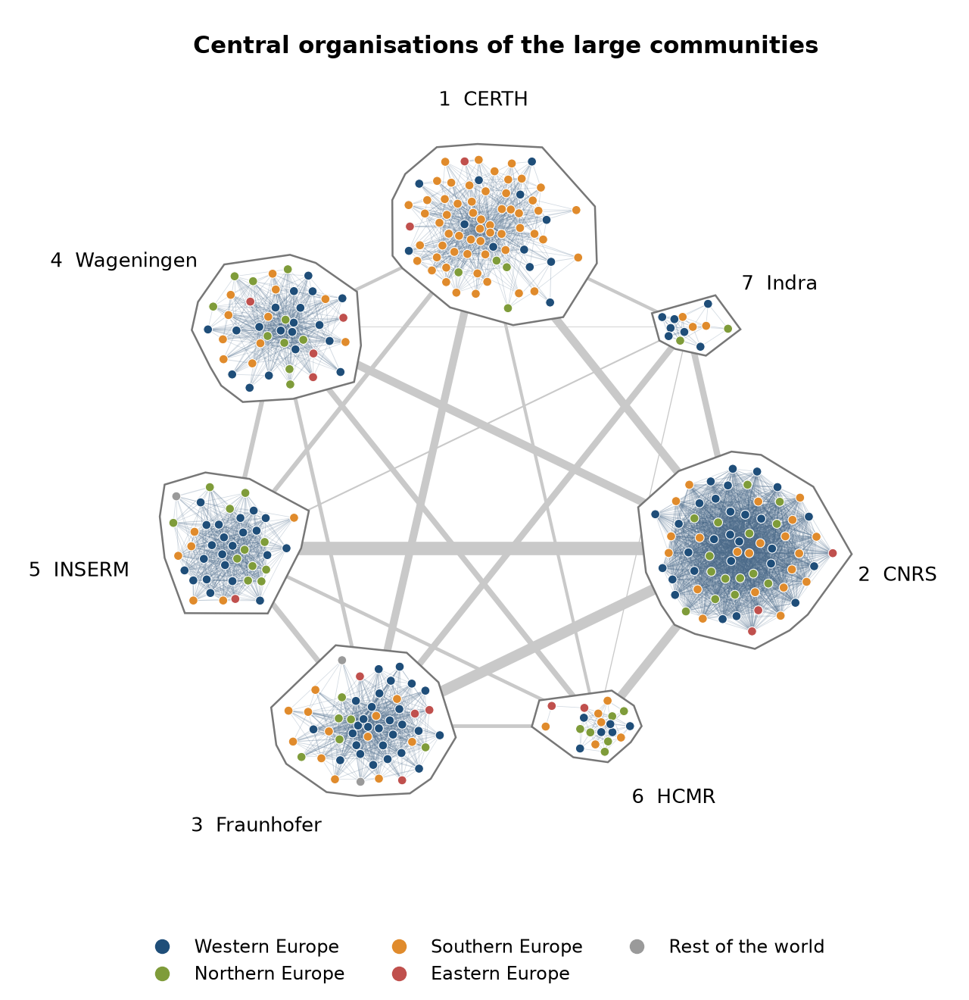

# Geography of the Core

**Centrality and Participation in the Horizon Europe Collaboration Network**

Final project for the *Social Network Analysis* course, University of Pisa, a.y. 2025/26.
Author: Giulia Rossi

This repository contains the data, the code and the report of a study of the collaboration network of Horizon Europe, the Framework Programme of the European Union for research and innovation. The network is built from the public CORDIS data: organisations are the nodes, and two organisations are linked when they take part in the same project.

## Research question

> In the communities of the Horizon Europe collaboration network, are the most central organisations evenly distributed across geographic areas? If not, is the difference explained by the number of projects each organisation takes part in, or does it remain when comparing organisations with the same number of projects?

## The network at a glance

| | |
|---|---|
| Source | CORDIS, Horizon Europe (2021–2027), snapshot of 28 September 2026 |
| Projects | 23,613, of which 12,541 with at least two participants |
| Participations | 145,631 organisation–project pairs |
| Nodes | 35,200 organisations |
| Links | 1,061,382, weighted by the number of shared projects |
| Giant component | 97.4% of the nodes |
| Average degree | 60.3 |
| Average path length | 2.72 |
| Average clustering | 0.78 |

## Main findings

<p align="center">
  
</p>
<p align="center"><em>The 311 central organisations of the seven large communities, coloured by area and grouped by community.</em></p>

**Much of the structure comes from how the network is built.** Every project links all its participants to each other. The clustering coefficient is 0.78, against 0.002 in an Erdős–Rényi graph and 0.009 in a Barabási–Albert graph of the same size, and a null model with random partners reaches half of the observed modularity (0.20 against 0.41).

**A small circle holds the network together.** Thirteen organisations fill the top-ten lists of six centrality measures. All of them are research organisations or universities, although private companies are 58% of the nodes, and the top 1% of the organisations hold 74% of the betweenness.

**Central organisations are unevenly distributed across areas.** The centre of a community is the 1% of its members with the most partners inside it.

| Area | % of members | % of central organisations | Ratio |
|---|---:|---:|---:|
| Western Europe | 34.6 | 39.2 | 1.13 |
| Northern Europe | 17.0 | 17.4 | 1.02 |
| Southern Europe | 29.1 | 37.3 | 1.28 |
| Eastern Europe | 8.6 | 5.1 | 0.60 |
| Rest of the world | 10.7 | 1.0 | 0.09 |

**Most of the imbalance mirrors participation.** Among organisations with the same number of projects, the four European areas differ by at most 0.03 in centrality percentile. A null model that keeps the participation of every organisation and assigns partners at random reproduces the share of central organisations of four areas out of five.

**The excess of Southern Europe comes from one community.** In the largest community, 57 of the 75 central organisations are in Southern Europe. In the other six together, Southern Europe holds about a quarter of the centres, close to its weight among their members.

**What participation does not explain concerns a few countries.** Greece has more central organisations than its participation would give (9.3% against 5.8% in the null networks), the United Kingdom and Germany fewer (3.5% against 7.4%, and 8.7% against 11.6%).

These results describe what remains at equal participation. They cannot establish where the differences in participation come from, since taking part in a project also depends on being included in a consortium. The report discusses this and the other limitations.

## Repository structure

```
.
├── notebooks/
│   ├── 01_data_collection.ipynb    # downloads the CORDIS archives and builds the data snapshot
│   ├── 02_build_network.ipynb      # cleans the data, describes them and builds the network
│   ├── 03_network_analysis.ipynb   # topology of the network, compared with ER and BA graphs
│   └── 04_open_question.ipynb      # communities, null model and centrality by geographic area
├── data/
│   ├── snapshot/                   # the two CORDIS tables used in the project
│   ├── network/                    # nodes and edges of the network
│   ├── participations/             # cleaned participations
│   └── raw/                        # downloaded archives (not in the repository)
├── figures/                        # figures produced by the notebooks
├── report/                         # final report: PDF and LaTeX sources
├── requirements.txt
└── README.md
```

## Notebooks

| Notebook | What it does | Reads | Writes |
|---|---|---|---|
| `01_data_collection` | Downloads the CSV and JSON exports of CORDIS, records their SHA-256 checksums and saves the two tables used in the project | CORDIS website | `data/raw/`, `data/snapshot/` |
| `02_build_network` | Cleans the participations, describes the data and builds the weighted network | `data/snapshot/` | `data/network/`, `data/participations/`, `figures/` |
| `03_network_analysis` | Degree distribution, components, paths, clustering, centrality and degree correlations, compared with two reference models | `data/network/` | `figures/` |
| `04_open_question` | Community detection, null model, central organisations by area and by country | `data/network/`, `data/participations/` | `figures/` |

## Reproducing the analysis

The notebooks were run with Python 3.12.

```bash
git clone https://github.com/grossi42/2026_rossi.git
cd 2026_rossi
pip install -r requirements.txt
jupyter notebook notebooks/
```

Run the notebooks in order, from `01` to `04`. A few things are worth knowing.

- **The results do not depend on the download date.** CORDIS replaces its exports every month. Notebooks 02 to 04 read the copy kept in `data/snapshot/`, which notebook 01 builds only once and never replaces. Running notebook 01 again downloads the current archives into `data/raw/` and reports whether they differ from those of the snapshot.
- **Notebooks 03 and 04 can be run on their own**, since they only read the files in `data/network/` and `data/participations/`.
- **Random seeds are fixed** in notebooks 03 and 04.
- **Notebook 04 takes about ten minutes**, because it builds twenty null networks and detects the communities of each.
- **Paths are relative to the `notebooks/` folder**, so the notebooks must be run from there.

## Data

The data come from [CORDIS – EU research projects under Horizon Europe (2021–2027)](https://data.europa.eu/data/datasets/cordis-eu-research-projects-under-horizon-europe-2021-2027), published by the Publications Office of the European Union on the EU Open Data Portal.

| File | Content |
|---|---|
| `data/snapshot/organization.csv.gz` | Participations as released by CORDIS: one row per organisation in each project |
| `data/snapshot/project_json.csv.gz` | Identifier and start date of every project |
| `data/snapshot/archives_sha256.json` | Checksums of the two archives the snapshot was built from |
| `data/network/nodes.csv.gz` | One row per organisation: `id`, `name`, `country`, `activityType`, `n_projects`, `n_coordinated`, `isolated` |
| `data/network/edges.csv.gz` | One row per pair of linked organisations: `source`, `target`, `weight` |
| `data/participations/participations.csv.gz` | Cleaned participations: `projectID`, `organisationID` |

Activity types follow the CORDIS codes: `HES` higher education, `REC` research organisation, `PRC` private company, `PUB` public body, `OTH` other. Countries follow the CORDIS codes, which use `EL` for Greece and `UK` for the United Kingdom.

## Method in brief

- **Network.** Projection of the bipartite network of organisations and projects. All four roles recorded by CORDIS generate links, every organisation–project pair counts once, and all the projects of the snapshot are included.
- **Reference models.** An Erdős–Rényi graph with the same number of nodes and links, and a Barabási–Albert graph with the same number of nodes and 30 links per new node.
- **Communities.** Louvain, Infomap and Label Propagation on the weighted network. The reference partition is the Louvain run with the highest modularity out of ten, and has seven communities with at least 1,000 members.
- **Centrality.** The number of partners of an organisation inside its own community. The centre of a community is the 1% of its members with the highest value.
- **Areas.** The four European regions of the United Nations geoscheme (M49), with Cyprus and Kosovo assigned to Southern Europe, and a fifth group for the rest of the world.
- **Null model.** Twenty networks in which organisations are reassigned at random among projects of the same size class. Every organisation keeps the number and the size class of its projects, and only its partners change.

## Report

The full report, *Geography of the Core: Centrality and Participation in the Horizon Europe Collaboration Network*, is in the [`report/`](report/) folder, with its LaTeX sources.

## Tools

[igraph](https://python.igraph.org), [NetworkX](https://networkx.org), [powerlaw](https://github.com/jeffalstott/powerlaw), pandas, NumPy, SciPy and Matplotlib.
